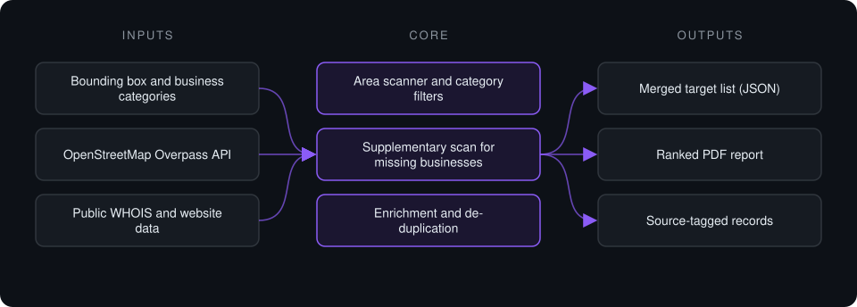

# Local Market Lead Scanner

**Maps every business of a chosen type inside a geographic area from open map data, enriches each one, and delivers a ranked PDF report.**

> **This is a proprietary project. Source code is private. This page showcases the system's architecture and capabilities.**

**Case study page:** [https://jryahia.github.io/showcase-local-market-lead-scanner/](https://jryahia.github.io/showcase-local-market-lead-scanner/)

## Problem it solves

Prospect lists for a local market are usually bought, stale, or assembled by hand from map searches. This pipeline builds the list from OpenStreetMap for an exact bounding box, fills gaps with a supplementary scan, adds website and domain-age data, removes duplicates, and produces a clean PDF ready for outreach planning.

## Architecture

1. The scanner queries Overpass for points of interest inside the bounding box and filters by category tags.
2. A supplementary pass looks for businesses that open map data tags poorly.
3. Each record is enriched with website presence and domain age, using parallel lookups.
4. Sources are merged and de-duplicated into one target list.
5. A report generator renders the final list as a readable PDF.

## Key features

- Exact geographic scoping by bounding box
- Two-source discovery with merge and de-duplication
- Domain-age estimation from WHOIS
- Parallel enrichment with retry
- PDF report output
- Open data only, no paid list providers

## Tech stack

     

## What it does in practice

- Produced a market map of local web and automation businesses for a city area in one run.
- Replaces manual map searching with a repeatable scan for any city and category.

---

Built by [Yahya Jarray](https://github.com/jryahia). Interested in a similar system? [Get in touch](mailto:yahiajarray43@gmail.com).

This repository contains no source code. It is a case study for a proprietary project. © Yahya Jarray.
